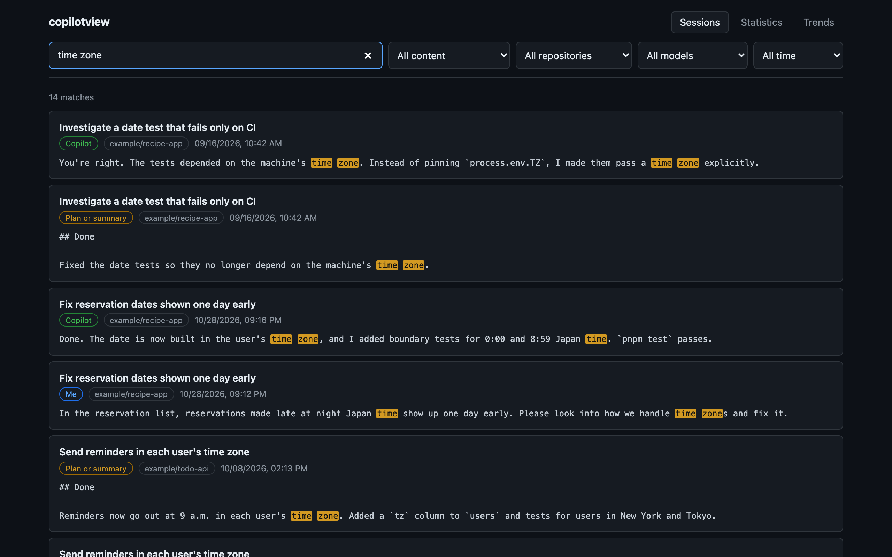
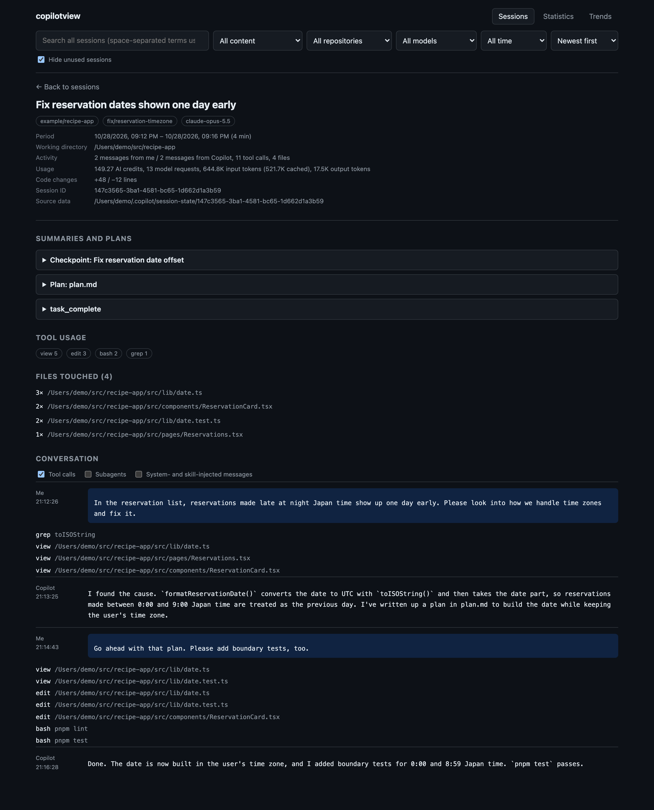
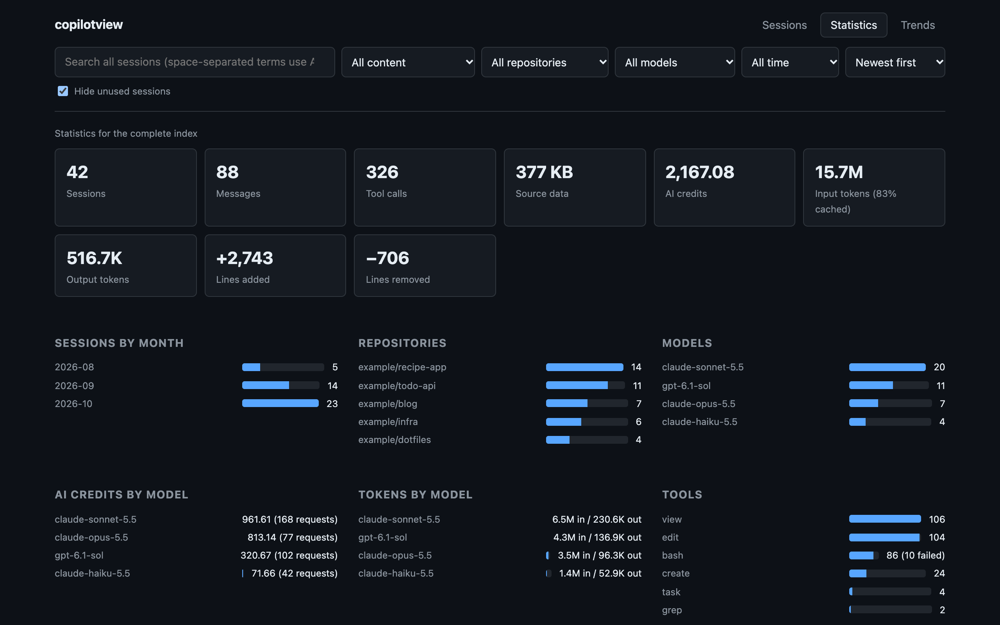
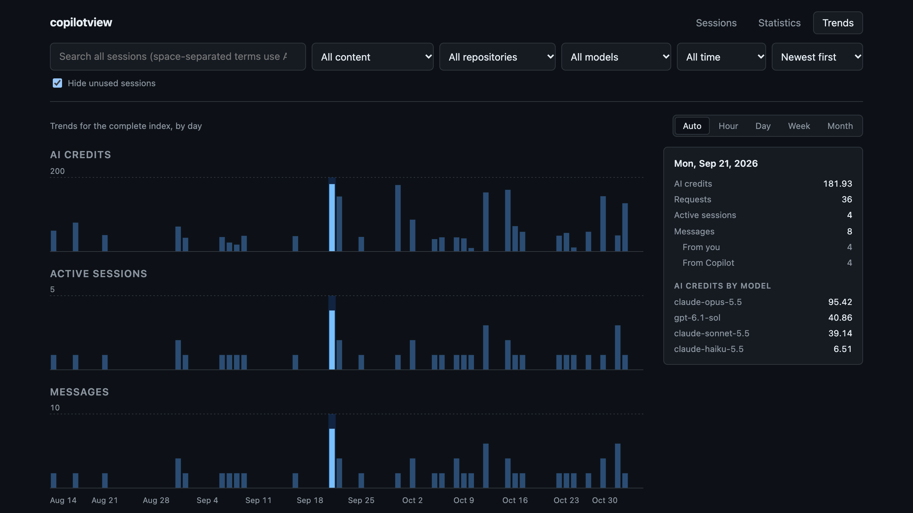

## What is this article about?

I recently released [copilotview](https://copilotview.mahata.org/). copilotview is a tool for searching your past [GitHub Copilot CLI](https://docs.github.com/en/copilot/concepts/copilot-surfaces/copilot-cli) and [GitHub Copilot app](https://docs.github.com/en/copilot/concepts/copilot-surfaces/github-copilot-app) sessions, reading them again, and adding up your usage. Everything happens on your own machine, and it never calls a remote API.

I built it because I wanted to go back and find conversations and decisions from past sessions. What I asked Copilot to do, how Copilot responded, and which approach we finally took all remain in the session records. It started with the idea of making those records full-text searchable. Later, while looking through the session data, I noticed that it also records how many AI credits were used, so I added usage statistics too.

> **Note:** copilotview is a personal project, not an official GitHub tool.

## Which sessions copilotview covers

copilotview reads the session records stored in `~/.copilot/session-state/`. Copilot CLI records the conversation and tool calls of each session in this directory. The Copilot app also runs Copilot CLI for each of its sessions and chats, so the sessions you run in the app on the same machine are recorded here in the same format. That's why copilotview can treat Copilot CLI and Copilot app sessions the same way.

On the other hand, history that isn't recorded in this directory is out of scope. For example, Copilot Chat history in VS Code is stored by VS Code, so copilotview can't search it.

## Installing and starting copilotview

You can install copilotview with Homebrew. It isn't in Homebrew's official repository (homebrew-core), so include the tap name when you install it.

```bash
brew install mahata/tap/copilotview
```

copilotview runs on Node.js, which Homebrew installs along with it as a dependency. To update to a new version, run `brew upgrade copilotview`.

Installing it gives you the `copilotview` command and `cv`, its shorter alias. Both work exactly the same, so this article uses `cv`. To start copilotview, run the following command:

```bash
cv serve
```

`cv serve` updates the search index and then starts the web UI. Open `http://127.0.0.1:4178` in your browser to see copilotview. Only the first indexing run takes a while. After that, copilotview re-reads only the sessions that have changed since the last run.

Besides `cv serve`, copilotview has the following commands:

- `cv index`: Updates the index without starting the web UI
- `cv stats`: Prints an overview of the index, such as the number of sessions and the most used repositories, models, and tools
- `cv --version`: Prints the version

> **Note:** If Homebrew's `bin` directory already has a `cv` from another tool, linking fails, and neither `cv` nor `copilotview` is available. In that case, run `brew link --overwrite copilotview`. It links copilotview, replacing the existing `cv` with copilotview's.

You can also build copilotview from source instead of using Homebrew. In that case, you need Node.js 24 or later and pnpm 12. See the [README](https://github.com/mahata/copilotview#readme) for the steps.

## What you can do with copilotview

copilotview has three pages: Sessions, Statistics, and Trends. The screenshots below show fictional sessions that I made up for this article.

### Search your past sessions

Enter search terms in the search box on the Sessions page, and copilotview runs a full-text search across all your sessions. The following image shows the results of searching for `time zone`.



Each result has a label that shows where the terms were found: "Me" for your own messages, "Copilot" for Copilot's responses, and "Plan or summary" for plans and summaries. copilotview can also search text in languages that don't put spaces between words, such as Japanese (I explain how in "Under the hood").

By default, copilotview searches everything in your sessions, but you can narrow the search to your messages, Copilot's responses, plans and summaries, or file names. You can also filter by repository, model, and period (a preset from the past 24 hours to the past year, or a range of dates). If you separate multiple terms with spaces, as in the example above, copilotview finds only the results that contain all of them.

### Reread a session

Open a session from the search results or the session list to see its details.



In the Conversation section, you can read your messages and Copilot's responses in chronological order, along with the tools Copilot called. Above the conversation, you'll find Summaries and plans, which brings together the plan (`plan.md`), checkpoints, and completion reports, along with the number of calls to each tool and the list of files touched. Comparing the conversation with the plan lets you trace, after the fact, how a change came about.

At the top of the page, along with the session's period and working directory, you can see the AI credits the session used, the number of model requests, token counts, and the lines added and removed.

### Add up your usage

The Statistics page adds up your usage across the whole index or for a period you choose.



At the top are the numbers of sessions, messages, and tool calls, along with AI credits, tokens, and lines added and removed. Below them are sessions by month, sessions by repository and by model, AI credits and tokens by model, and calls by tool. They're cut off in the image, but further down you'll also find the median duration of each tool and sessions by branch.

### Watch your usage over time

The Trends page shows bar charts of AI credits, active sessions, and messages over time.



Each bar can cover an hour, a day, a week, or a month (Auto picks one to fit the period). Hover over a bar, and the values for its period appear on the right, including AI credits broken down by model.

### How AI credits are counted

The AI credits shown in copilotview are totals of the values that Copilot CLI records for each session (1 AI credit equals $0.01 USD[^billing]). However, Copilot CLI versions before 1.0.44 didn't record AI credits. copilotview doesn't estimate the AI credits of such old sessions from their token counts and treats them as not recorded. Model prices and discounts can change, so an estimate could differ from the AI credits you actually used.

## Privacy and safety

copilotview only reads `~/.copilot/session-state/` and never modifies the original records. The only thing it writes is its search index (`~/.copilotview/index.db`).

It doesn't send your session content to any external service, either. It doesn't call an LLM, so the summaries you see aren't generated by copilotview. Instead, it gathers and displays information that the sessions already record: the summary in `workspace.yaml`, completion reports, and checkpoints. You don't need to sign in to GitHub or set up a token.

By default, the web UI listens only on `127.0.0.1`. The web UI has no authentication, so I don't recommend changing the listening address with the `--host` option to open it from other machines. Your session records contain your conversations, file paths, and the commands you ran.

The index doesn't store tool output, such as command results and file contents. As a result, the index is much smaller than the original records. On my machine, 1.2 GB of session records fit in an index of about 30 MB.

## Under the hood

copilotview is written in TypeScript, with Hono for the server and React for the web UI. For the index, I used `node:sqlite`, which is built into Node.js. Because there are no native modules to build, Node.js is all you need to run copilotview.

For full-text search, I used SQLite's FTS5 with the trigram tokenizer. The trigram tokenizer indexes every run of three consecutive characters, so it can search Japanese without splitting the text into words. In exchange, terms shorter than three characters can't be looked up in the index. copilotview therefore finds one- and two-character terms, such as `CI` or the Japanese word 日付 ("date"), with a sequential `LIKE` scan. When this happens, copilotview says so next to the number of results.

## Current limitations

The format of the records in `~/.copilot/session-state/` isn't a published specification. copilotview reads the records that Copilot CLI actually writes, so if a Copilot CLI update changes the format, copilotview may stop reading them correctly. To avoid depending on more unpublished formats like this, copilotview doesn't read the database that Copilot uses internally (`~/.copilot/session-store.db`).

Sessions updated while `cv serve` is running don't show up automatically. To include them, run `cv index` or restart `cv serve`.

This article is based on v0.13.0, the latest version at the time of writing. I update copilotview frequently, so check the [README](https://github.com/mahata/copilotview#readme) for the latest behavior.

## Feedback and requests

copilotview is MIT licensed, and [its source code is available on GitHub](https://github.com/mahata/copilotview). If you use Copilot CLI or the Copilot app, please give it a try. If you find a bug or have something you'd like improved, let me know in [Issues](https://github.com/mahata/copilotview/issues).

[^billing]: For details on AI credits, see "[GitHub Copilot billing](https://docs.github.com/en/billing/concepts/product-billing/github-copilot-billing)" in the GitHub Docs.
