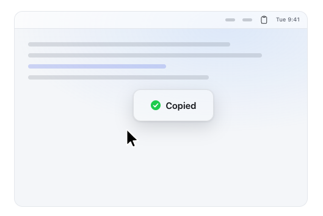

## What is this article about?

I recently released [Strongcopy](https://strongcopy.mahata.org/).

Strongcopy is a macOS app that lets you confirm that something was actually copied to the clipboard. Copy-and-paste mistakes are hard to notice in time. Sometimes you only realize that you failed to copy something when you go to paste it.

Strongcopy is a tool to prevent such mistakes. When data lands on the clipboard, a small badge appears for a moment so you can confirm the copy.

## User experience

[The Strongcopy landing page](https://strongcopy.mahata.org/) shows the small badge that appears when you copy something. You can see the `Copied` badge next to the mouse pointer.

The badge flashes beside the mouse pointer the moment the clipboard contents change, then disappears in under a second. The menu bar icon tells you that the app is running, and the badge tells you that your copy has just gone through.

## Privacy and safety

Strongcopy doesn't read, log, or retain your clipboard contents. It needs neither Accessibility nor notification permission, and it makes no network connections. In fact, Strongcopy's codebase is small enough that you can read and understand it yourself. [The source code is available on GitHub](https://github.com/mahata/strongcopy).

Strongcopy runs as a background accessory app.

It has no Dock icon; all you see is a single icon in the menu bar. Its menu offers little more than **About**, **Open at Login**, and **Quit**. It's a simple little app.

## Feedback and requests

If you'd like, please take a look at [the Strongcopy page](https://strongcopy.mahata.org/) and let me know if anything catches your attention or if there's something you'd like improved.
