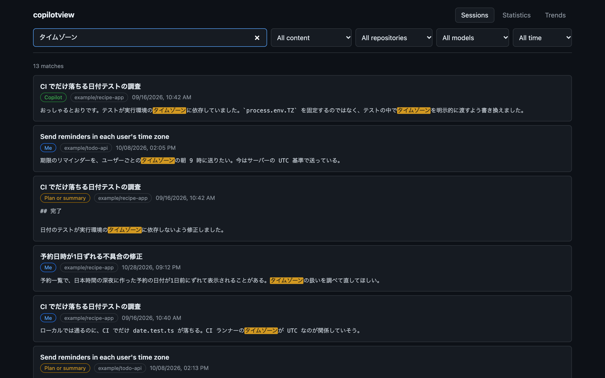
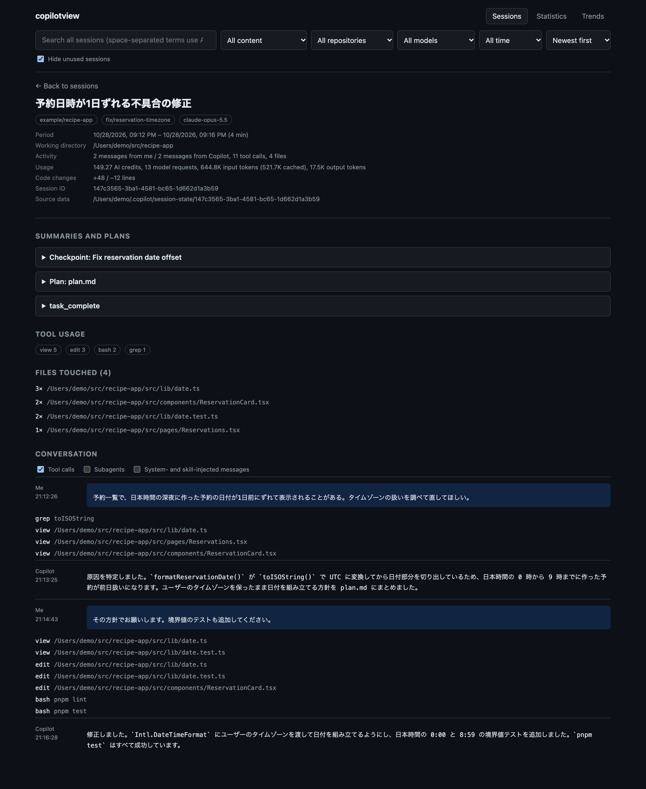
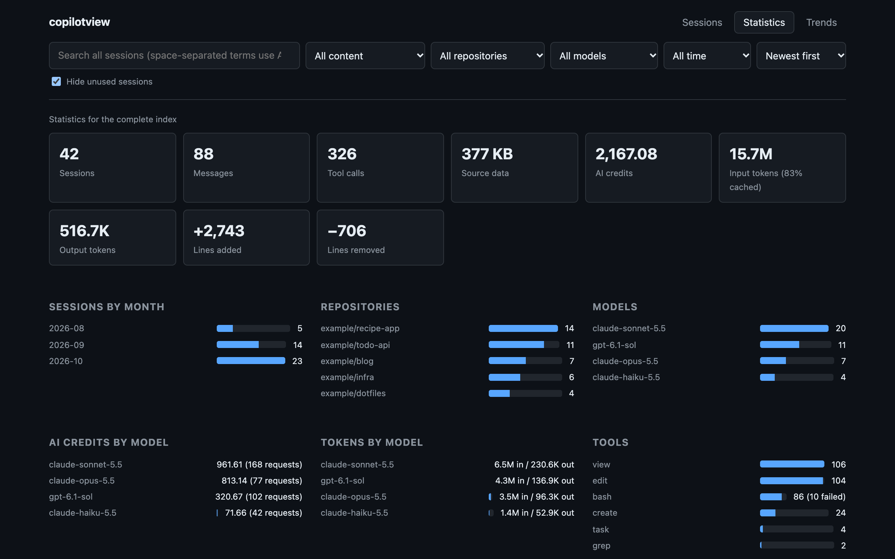
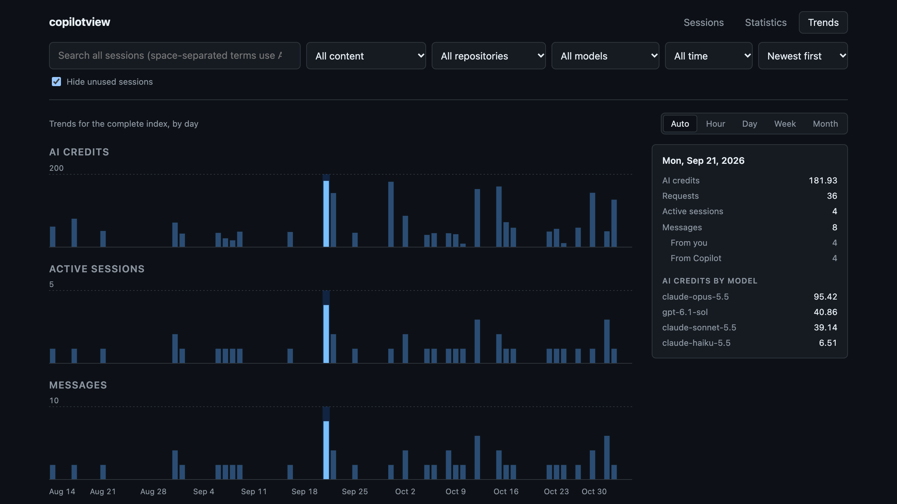

## この記事は何ですか?

先日、[copilotview](https://copilotview.mahata.org/) を公開しました。copilotview は、[GitHub Copilot CLI](https://docs.github.com/ja/copilot/concepts/agents/about-copilot-cli) と [GitHub Copilot app](https://docs.github.com/ja/copilot/concepts/copilot-surfaces/github-copilot-app) の過去のセッションを検索したり、読み返したり、使用量を集計したりするツールです。処理はすべて手元のマシンの中で完結し、リモートの API は呼び出しません。

作ったきっかけは、過去のセッションでの会話や判断を後から探したかったことです。Copilot に何を頼み、Copilot がどう答え、最終的にどの方針で進めたのかは、セッションの記録に残っています。それを全文検索できるようにしようと考えたのが始まりでした。その後、セッションのデータを眺めているうちに AI credits の使用量も記録されていると気づき、使用量を集計する機能を足しました。

:::message
copilotview は僕が個人で開発しているツールで、GitHub の公式ツールではありません。
:::

## 対象になるセッション

copilotview が読むのは、`~/.copilot/session-state/` に保存されているセッションの記録です。Copilot CLI は、セッションごとの会話やツールの呼び出しをこのディレクトリに記録します。Copilot app もセッションやチャットごとに Copilot CLI を動かしているので、このマシンで動かしたアプリのセッションも同じ形式でここに記録されます。そのため copilotview は、Copilot CLI と Copilot app のセッションを区別せずに扱えます。

一方で、このディレクトリに記録されない履歴は対象外です。たとえば VS Code の Copilot Chat の履歴は VS Code 側に保存されるので、copilotview では検索できません。

## インストールと起動

copilotview は Homebrew でインストールできます。Homebrew の公式リポジトリ（homebrew-core）には登録していないので、tap 名を含めて指定します。

```bash
brew install mahata/tap/copilotview
```

copilotview は Node.js で動きますが、Node.js は依存関係として Homebrew が一緒にインストールします。新しいバージョンへの更新は `brew upgrade copilotview` で行えます。

インストールすると、`copilotview` コマンドと、その短い別名の `cv` コマンドが入ります。どちらで実行しても動作は同じなので、この記事では `cv` で書きます。copilotview を起動するには、次のコマンドを実行します。

```bash
cv serve
```

`cv serve` は、検索用のインデックスを更新してから Web UI を起動します。ブラウザで `http://127.0.0.1:4178` を開くと、copilotview の画面が表示されます。インデックスの作成に時間がかかるのは最初の 1 回だけです。2 回目以降は、前回から変わったセッションだけを読み直します。

`cv serve` のほかに、次のコマンドがあります。

- `cv index`：Web UI を起動せずに、インデックスだけを更新します
- `cv stats`：インデックスの概要（セッション数や、よく使われているリポジトリ、モデル、ツールなど）を表示します
- `cv --version`：バージョンを表示します

:::message
Homebrew の `bin` ディレクトリに別のツールの `cv` がすでにあると、リンクに失敗し、`cv` だけでなく `copilotview` も使えない状態になります。その場合は `brew link --overwrite copilotview` を実行してください。既存の `cv` を copilotview のものに置き換えてリンクします。
:::

Homebrew を使わずに、ソースコードからビルドすることもできます。その場合は Node.js 24 以上と pnpm 12 が必要です。手順は [README](https://github.com/mahata/copilotview#readme) を参照してください。

## copilotview でできること

copilotview の画面には、Sessions、Statistics、Trends の 3 つのページがあります。以下のスクリーンショットは、説明のために作った架空のセッションを表示したものです。

### 過去のセッションを全文検索する

Sessions ページの検索ボックスに検索語を入れると、すべてのセッションをまとめて全文検索します。次の画像は「タイムゾーン」で検索した結果です。



検索結果には、検索語が見つかった場所がラベルで示されます。自分のメッセージなら「Me」、Copilot の応答なら「Copilot」、プランやサマリーなら「Plan or summary」です。画像のとおり、日本語もそのまま検索できます（仕組みは「技術的な話」で説明します）。

既定ではセッションのすべての内容を検索しますが、自分のメッセージ、Copilot の応答、プランとサマリー、ファイル名のどれかに対象を絞ることもできます。リポジトリ、モデル、期間（過去 24 時間から過去 1 年までの選択肢か、日付の範囲）でも絞り込めます。複数の検索語をスペースで区切ると、すべての検索語を含むものだけが見つかります。

### セッションを読み返す

検索結果や一覧からセッションを開くと、そのセッションの詳細が表示されます。



Conversation の欄では、自分のメッセージと Copilot の応答を、Copilot が呼び出したツールと一緒に時系列で読めます。その上には、プラン（`plan.md`）、チェックポイント、完了報告をまとめた Summaries and plans と、ツールごとの呼び出し回数、触ったファイルの一覧が並びます。会話とプランを突き合わせれば、どういう経緯でその変更に至ったのかを後から追えます。

画面の上部には、セッションの期間や作業ディレクトリに加えて、そのセッションで使った AI credits、モデルの呼び出し回数、トークン数、追加と削除の行数も表示されます。

### 使用量を集計する

Statistics ページでは、インデックス全体、または選んだ期間について使用量を集計します。



上段には、セッション数、メッセージ数、ツールの呼び出し回数、AI credits、トークン数、追加と削除の行数が並びます。その下には、月ごとのセッション数、リポジトリ別とモデル別のセッション数、モデル別の AI credits とトークン数、ツール別の呼び出し回数が続きます。画像では切れていますが、さらに下にはツールの所要時間の中央値と、ブランチ別のセッション数もあります。

### 使用量の推移を見る

Trends ページでは、AI credits、アクティブなセッション数、メッセージ数の推移を棒グラフで表示します。



棒の単位は、時間、日、週、月から選べます（Auto を選ぶと、期間に合わせて自動で決まります）。棒にマウスカーソルを合わせると、その棒の期間の値が右側に表示され、AI credits のモデル別の内訳も分かります。

### AI credits の数え方

copilotview が表示する AI credits は、Copilot CLI がセッションの記録に残している値を集計したものです（1 AI credit は 0.01 米ドルに当たります[^billing]）。ただし、Copilot CLI 1.0.44 より前のバージョンは AI credits を記録していませんでした。copilotview は、そうした古いセッションの AI credits をトークン数から推定せず、記録されていないものとして扱います。モデルの単価や割引は変わることがあるので、推定値が実際に消費した AI credits とずれてしまうからです。

## プライバシーと安全性

copilotview は `~/.copilot/session-state/` を読むだけで、元の記録を書き換えません。書き込むのは、検索用のインデックス（`~/.copilotview/index.db`）だけです。

セッションの内容を外部のサービスに送ることもありません。LLM も呼び出さないので、画面に出るサマリーは copilotview が生成したものではありません。セッションがもともと記録している情報（`workspace.yaml` の summary、完了報告、チェックポイント）を集めて表示しています。GitHub へのログインやトークンの設定も不要です。

Web UI は、既定では `127.0.0.1` でだけ待ち受けます。Web UI には認証の仕組みがないので、`--host` オプションで待ち受けるアドレスを変えて、ほかのマシンから開けるようにするのはおすすめしません。セッションの記録には、会話の内容やファイルのパス、実行したコマンドが含まれているからです。

インデックスには、ツールの出力（コマンドの実行結果やファイルの中身など）を保存していません。そのため、インデックスは元の記録よりずっと小さく収まります。僕の環境では、1.2 GB のセッションの記録が約 30 MB のインデックスに収まりました。

## 技術的な話

copilotview は TypeScript で書いていて、サーバーには Hono、Web UI には React を使っています。インデックスには、Node.js に組み込まれている `node:sqlite` を使いました。ネイティブモジュールをビルドする必要がないので、copilotview を動かすのに必要なものは Node.js だけです。

全文検索には SQLite の FTS5 を使い、トークナイザーには trigram を選びました。trigram はテキストを 3 文字ずつの組に分けて索引を作るので、日本語を単語に区切らなくても検索できます。SQLite に組み込まれているトークナイザーのうち、日本語を索引できるのは trigram だけです。

その代わり、3 文字に満たない語では索引を引けません。そこで copilotview は、1 文字や 2 文字の語（たとえば「日付」）を `LIKE` による逐次検索で探します。この切り替えが起きたときは、検索結果の件数の横にその旨を表示します。

## 現時点での制限

`~/.copilot/session-state/` の記録形式は、公開されている仕様ではありません。copilotview は Copilot CLI が実際に書き出している記録を読んでいるので、Copilot CLI の更新で形式が変わると、正しく読めなくなるおそれがあります。このような非公開の形式への依存を増やさないよう、Copilot が内部で使っているデータベース（`~/.copilot/session-store.db`）は読まないようにしています。

`cv serve` を起動している間に更新されたセッションは、自動では反映されません。反映するには、`cv index` を実行するか、`cv serve` を起動し直してください。

この記事の内容は、執筆時点の最新版である v0.13.0 に基づいています。copilotview は頻繁に更新しているので、最新の挙動は [README](https://github.com/mahata/copilotview#readme) で確認してください。

## ご意見、ご要望

copilotview は MIT ライセンスで、[ソースコードを GitHub で公開しています](https://github.com/mahata/copilotview)。Copilot CLI や Copilot app を使っている方は、ぜひ試してみてください。不具合や改善してほしい点があれば、[Issues](https://github.com/mahata/copilotview/issues) で教えてください。

[^billing]: AI credits の詳細は、GitHub のドキュメント「[GitHub Copilot の料金](https://docs.github.com/ja/billing/concepts/product-billing/github-copilot-billing)」を参照してください。
